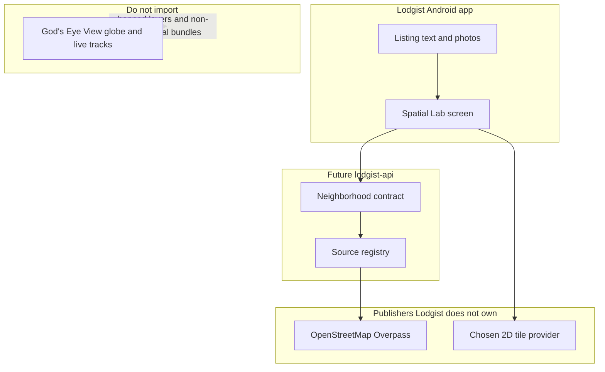

# Spatial Lab audit and Lodgist integration boundary

> [!NOTE]
> **Assessment Baseline (4 October 2026)**: This document reflects the historical architectural assessment at commit `3ad97a3`. For the current feature branch and contract status as of November 2026, see [Current State Addendum (November 2026)](#current-state-addendum-november-2026).

Date: 4 October 2026. This is an architecture assessment, not an implementation plan and not a security audit. It does not authorize copying God's Eye View into Lodgist.

## Verdict

Needs seam work. Do not embed God's Eye View in Lodgist, and do not treat spatial-lab as a map product yet.

spatial-lab is a small ShadowSpark experiment that restates a housing-relevant slice of God's Eye View. It is not a fork. The useful idea is neighborhood context for one listing. The globe, live tracking layers, voice cockpit, and bundled datasets are the wrong product for a Nigerian rental app.

Readiness: needs seam work. Stop condition: no God's Eye View file is copied until three things exist: one response shape that the loader actually returns, listing coordinates with an explicit precision, and a pinned-commit extraction manifest. A 2D map with a text fallback is the first Lodgist surface. A 3D globe is not.

## What was asked, and what the names actually are

The remembered domain is close, not exact. The newsletter is Map the World at maptheworld.ai, also published as Spatial Intelligence.[2][1] It is Bilawal Sidhu's newsletter, not the application.[2]

The open-source application is God's Eye View, repository bilawalsidhu/gods-eye-view.[1][6]
Sidhu described it as a spy-satellite simulator whose data is public, and said the code was opened because people asked for it.[6][1]
The repository page also says an official hosted version is being built at Halfpixel, with no install required.[1]
That hosted product is announced, not a dependency Lodgist should wait on.

Local evidence, separate from those pages:

- Observed: /home/moronto/spatial-lab tracks https://github.com/SHADOWSPARK-TECHNOLOGIES/spatial-lab.git on main at 3ad97a3, even with origin/main. Seven commits. No LICENSE file. README states it is not a fork of God's Eye View.
- Observed: /home/moronto/Documents/gods-eye-view tracks upstream bilawalsidhu/gods-eye-view at 81eb443 (27 September 2026). That snapshot is behind the repository page fetched the same day as this assessment, whose latest noted commit was hours old. Claims about current upstream behavior that were not re-read on main are unknown.
- Observed: a separate GitHub fork, Morontowonderz/gods-eye-view, was last pushed 12 September 2026. spatial-lab does not use that fork as its remote.
- Inferred: spatial-lab was born from the God's Eye View idea and from the Lodgist development brief, not by forking the git history. The brief names the upstream repository and limits reuse to map focus, markers, layers, and view-state sharing.

## Evidence ledger

| Claim | Status | Evidence |
| --- | --- | --- |
| maptheworld.ai is the newsletter behind the project, not the app | reported | Repository page and the newsletter itself.[1][2] |
| God's Eye View source is MIT; third-party data is not | reported | Upstream LICENSE note on main.[7] Same carve-out is present in the local snapshot's data-source file. |
| spatial-lab is not a God's Eye View fork and contains no copied upstream source file | observed | Own initial commit, README, extraction note, no LICENSE, no Cesium or provider tree |
| v0 response shape and the loader do not match | observed | docs/V0_CONTRACT.md versus src/neighborhood/catalog.js and overpass.js on main |
| An unmerged branch records that mismatch and does not fix the payload | observed | docs/overpass-contract at b6450d6, worktree only, not on origin/main |
| Lodgist cannot place a pin today | observed | Property.location is a string. Play Services location is commented out. No map SDK |
| Google Photorealistic 3D Tiles cover Owerri well enough for a rental map | unknown | Not measured in this assessment |
| Public Overpass is a production amenity service for Lodgist | unknown | Lab calls a fixed public host. The registry still marks the source under review |

## God's Eye View, as a system

Observed from the local snapshot's layout, README, and data-source file, checked against the upstream license note.[7]

It is a browser application. A Cesium globe renders in the page. A local Node process proxies live feeds so keys stay off the client. There is no application database. Layers are separate modules: flights, military traffic, vessels, satellites, earthquakes, fires, traffic, transit, weather, cameras, radio, and others. Voice control is an optional realtime agent over that globe. The project says it is a hackable exploration client, not a hardened production service.[1]

Data authority is outside the app. Each feed's publisher owns the fact. The app holds short-lived caches and shows attribution. Bundled datasets keep their own licenses. The MIT grant does not extend to any third-party data.[7] OpenSky is called out there as restricting commercial use. The local data-source file also marks TeleGeography cable data and the Bhote Koshi event pack as non-commercial, and says the public FOSSGIS routing servers allow commercial use only with restrictions. Those last two points are observed in the 27 September snapshot, not re-verified on today's main.

Privacy posture, reported by the project and matching spatial-lab's own ban list: public signals, no face recognition, no person search. That still includes public cameras, plate-reader locations, military traffic, and live vehicle tracks. Those are legitimate for an OSINT globe and prohibited for Lodgist.

Coupling, if Lodgist imported the app:

- Static: the globe, layer registry, voice tools, and proxy are one Node package. A housing map would import a surveillance client to reach a camera helper.
- Dynamic: most layers poll live feeds. A property page does not need that fan-out, and a timeout in one feed is the wrong failure for a listing.
- Data: Lodgist must not inherit bundled non-commercial datasets or cache Google Maps content. The local data-source file says Google content may not be cached or rehosted.
- Temporal: live tracks are "now." A rental decision needs a retrieval time and a freshness label, not a moving contact.
- Deployment: God's Eye View expects Node 24.14+ or 26, a local dev server, and optional paid keys. Lodgist's current app is Android, Kotlin, Compose, and Room.
- Organizational: upstream is a fast-moving public project (the fetched page showed hundreds of commits and a commit the same day). Vendoring it makes Lodgist track their cockpit, not a housing map.

Change coupling is high. The local snapshot and today's main already disagree on feed route names. Pin a commit before any extraction. Do not track main.

## spatial-lab, as it actually is

Observed on main, 351 lines outside git, four product files under src/neighborhood, plus docs and one agent skill.

What it is: a contract and a bounded amenity loader. No map. No Android module. No server. package.json has a name and no scripts. Six node:test cases passed on 4 October 2026. They check the ban list, a fixed Overpass host, refusal of a caller-supplied URL, and that errors return no invented amenities. They do not check the v0 response fields.

What the README promises: neighborhood context for a property decision. Sequence is neighborhood, then traffic and weather after a source is cleared, then terrain, then a labeled AI summary, then a WhatsApp spatial ask. Area context is not a safety rating. Secret keys stay on a future lodgist-api.

What the loader does: given a listing id and WGS84 coordinates, it can build a query for hospital, school, marketplace, and pharmacy nodes inside a caller-supplied radius, capped at 2 km, and post that query only to the public Overpass interpreter when the caller supplies the fetch function. It refuses a caller-supplied URL. It attaches the OpenStreetMap attribution string. It drops elements that are not those four amenities. It does not compute distance. It does not set source_id or kind. It does not query roads or transit. It does not call the network in tests.

### Contract drift

This is the defect that blocks integration. Three descriptions of the same response disagree.

| Surface | What it says | Status |
| --- | --- | --- |
| docs/V0_CONTRACT.md on main | One property pin plus items with category, straight-line distance, source id, and kind (source, derived, or inference). Categories include roads and transit | observed |
| src/neighborhood on main | Catalog returns pin, layer ids, and an empty amenity list. Loader returns amenities with a layer name and attribution, or a failure with an empty list | observed |
| docs/extraction.md on main | Says there is no Overpass call. The loader on the same commit does have one | observed |
| docs/DATA_SOURCES.md | Says nothing in the registry is cleared for production Lodgist. OpenStreetMap Overpass is under review, not cleared | observed |
| Branch docs/overpass-contract, unmerged | Documents that the loader emits four categories and does not query roads or transit. Does not change the payload to the v0 item shape | observed |
| Lodgist development brief, section 8 | Also wants campus, shops, clinics, transport stops, distance controls, legend, attribution, retrieval date, and a text alternative | observed |

The brief and the lab also disagree on stack. The brief says to verify a prior Next.js, Prisma, and Postgres record. The app inspected here is Android. Wiring spatial-lab into a web stack that is not this repository would miss the product that exists.

Allowed-layer policy is the part that is already right. Flights, military, vessels, satellites, cameras, plate readers, radio, cables, fires, and earthquakes are rejected in the catalog, and the tests lock that rejection. Keep that ban. Do not "integrate God's Eye View" by enabling those layers later.

## What Lodgist can use, and what it must not

Useful patterns, reimplemented or extracted later under MIT notice if a file is actually copied:

- Focus one property, or an approximate area when the pin is not exact.
- Separate source facts, derived values such as straight-line distance, and model inference.
- Fail closed: empty, error, and stale return no invented amenities.
- Fixed upstream host. No user-supplied URL fetch.
- Attribution kept on the payload, not only in a comment.
- Server-side keys. The Android client never holds a provider secret.

Not useful for Lodgist, even though they are the impressive part of God's Eye View:

- Photorealistic globe, cockpit, sensor skins, military HUD, scene director, share-a-tracked-target.
- Live aircraft, ships, satellites, earthquakes, fires, public cameras, plate-reader maps, radio, military installations.
- Bundled non-commercial datasets.
- Voice agent that flies a globe. A later WhatsApp ask can query the same neighborhood contract. It should not embed the cockpit.
- Public FOSSGIS routing as a commercial journey-time engine. The snapshot says commercial use is restricted. Journey time needs a provider Lodgist has rights to use, plus mode, retrieval time, and an estimate label. Straight-line distance can exist without that provider.
- Google 3D tiles as the first map. Coverage in the pilot cities was not measured. The brief already says start with a fast 2D map and load 3D only if coverage, cost, and phone performance justify it.

OpenStreetMap via a bounded Overpass query is the only live source the lab touches. ODbL allows commercial use with attribution, and share-alike applies to a published derivative database, not automatically to an app. That reading is in spatial-lab's own registry and matches the usual ODbL split. It is not a production clearance: the registry still says under review, the public interpreter is a shared courtesy service, and Nigeria amenity completeness is unknown until a real Owerri or Lagos extract is inspected. Do not bundle an extract into the app.

## Boundary for Lodgist

Data authority:

- The listing owner, or Lodgist's review record, owns the property coordinate and its precision: exact, approximate, or unknown. spatial-lab must not invent a precise pin. Today Lodgist has only a location string, so this authority does not exist yet.
- OpenStreetMap contributors own amenity geometry. Lodgist may derive straight-line distance and must label it as derived.
- A map tile provider owns imagery. Date and attribution stay with the tile response. Do not cache outside the provider terms.
- No God's Eye View feed is a source of truth for whether a home is safe, powered, or legally advertised.

Consistency: one request, one property. If Overpass fails, the listing text still renders. There is no multi-service transaction. There is no reconciliation job because nothing is written back to OpenStreetMap.

Failure: the loader already returns an empty list on HTTP failure, oversize body, and bad JSON. That is the right user-visible state. It does not yet tell the app whether the result is stale, and the catalog's stale status is a separate function the loader does not call. That seam is unresolved.

## Coupling verdict

| Lens | If the globe is embedded | If only the neighborhood contract is used |
| --- | --- | --- |
| Static | High. One package, many layers | Low, once the response shape is one |
| Dynamic | Live poll fan-out unrelated to a listing | One bounded query, fail closed |
| Data | Non-commercial bundles and uncacheable tiles leak in | One ODbL source, attribution required, not yet cleared |
| Temporal | "Now" tracks versus a listing decision | Retrieval time still missing |
| Deployment | Node globe beside an Android app | A small server module the app can call |
| Organizational | Track upstream cockpit changes | ShadowSpark owns the housing contract |

Alternatives rejected: vendoring the God's Eye View repository, wrapping it in a WebView, and waiting for the Halfpixel host. The first two import banned layers and a deployment Lodgist does not run. The third is someone else's product schedule.[1]

Next reversible probe, not an implementation authorization: on the spatial-lab contract only, make one fixture response that a reader can check against the v0 fields, including an approximate pin and a failed fetch. Do not call the public Overpass from Lodgist until the registry marks that source cleared and a real pilot bbox has been reviewed for coverage.

## What this assessment does not do

It does not copy God's Eye View source, does not change Lodgist, and does not clear a data source for production. API design for the neighborhood endpoint belongs to a later interface review. Building the Android map belongs to mobile work after the coordinate model exists. A migration of God's Eye View code, if any file is ever copied, needs a separate extraction manifest at a pinned commit, with license notices and a list of excluded datasets.

## Sources

[1] https://github.com/bilawalsidhu/gods-eye-view — God's Eye View (bilawalsidhu)
    > "A spy satellite simulator in your browser, except the data is real. Live open source spatial intelligence on a photorealistic 3D globe."
    > "So we're building an official hosted God's Eye View at Halfpixel: no installation, just open it in your browser."
    > "Map the World — the newsletter behind the project"
[2] https://maptheworld.ai — Map the World by Bilawal Sidhu
    > "Mapped the world at Google. Now mapping the frontier of creation & computing."
[6] https://www.spatialintelligence.ai/p/i-open-sourced-gods-eye-view — I Open Sourced God's Eye View
    > "You asked, so it’s happening. God’s Eye View, open sourced, live on GitHub."
[7] https://raw.githubusercontent.com/bilawalsidhu/gods-eye-view/main/LICENSE — GEV LICENSE (raw main)
    > "In short: the MIT grant does not extend to any third-party data."

---

## Current State Addendum (November 2026)

### 1. Contract & Loader Evolution
- `package.json` now includes `scripts.test` (`node --test`), `scripts.ci`, and automatic git pre-push hook configuration (`prepare`).
- The v0 contract adapter is implemented (`src/neighborhood/assemble.js` and `overpass.js`), emitting the exact contract shape: `property`, `items` (with `category`, `lat`, `lng`, `distance_m`, `distance_label`, `source_id`, `kind`).
- Coordinate validation is hardened with `Number.isFinite` in `src/neighborhood/catalog.js`.

### 2. Issue #6 Deliverables Status Matrix

| Deliverable | Status | Evidence / Notes |
|---|---|---|
| Upstream GEV source/license audit | VERIFIED (No Code Copied) | Audit confirmed upstream MIT code vs third-party non-commercial data boundaries. No upstream source files copied. |
| Runnable neighborhood explorer contract | VERIFIED | Schema contract verified by 17 unit tests. Straight-line distances explicitly labeled as derived. |
| Provider decision matrix | PARTIAL / UNDER REVIEW | `docs/DATA_SOURCES.md` maintains `osm-overpass-extract` under review. No production clearance. |
| Failed/empty/low-bandwidth UX tests | VERIFIED | Tests in `overpass.test.js` and `assemble.test.js` verify fail-closed behavior on HTTP error, timeout, and empty results. |
| PR with code & tests | OPEN (PR #7) | PR #7 open against `main`. 17/17 tests passing locally. Zero production deployment authorized. |

